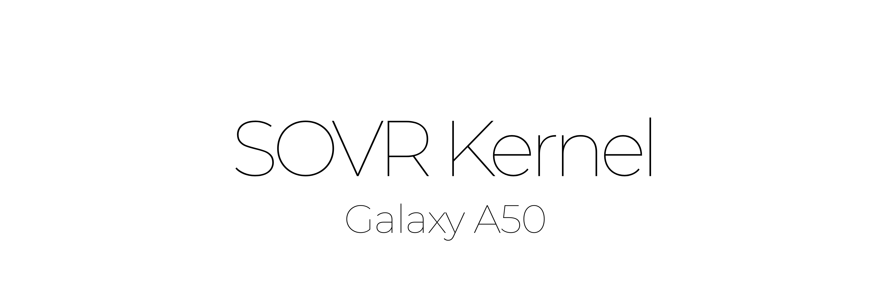

<p align="center">
  <picture>
    <source media="(prefers-color-scheme: dark)" srcset="assets/sovr_kernel_dark.png">
    <source media="(prefers-color-scheme: light)" srcset="assets/sovr_kernel_light.png">
    
  </picture>
</p>

<p align="center">
  <a href="https://github.com/openela/kernel-lts"></a>
  <a href="https://github.com/SOVR-Technologies/SOVR-Kernel-A50/releases"></a>
  <a href="https://semiconductor.samsung.com"></a>
  <a href="https://github.com/Neutron-Toolchains/clang-build-catalogue"></a>
  <a href="https://github.com/KernelSU-Next/KernelSU-Next"></a>
  <a href="https://gitlab.com/simonpunk/susfs4ksu"></a>
  <a href="https://docs.kernel.org/admin-guide/mm/multigen_lru.html"></a>
  
  
  
</p>

---

> [!IMPORTANT]
> ### 📢 Release Status & Community Testing Rings (v4.1 Final)
> * **One UI 6+ (Android 14) — 1000% Verified Stable:** The One UI 6 release packages (`SOVR-Kernel-v4.1.A14_OneUI6_A50_KSU.zip` and non-root) have undergone comprehensive physical hardware validation on real Galaxy A50 devices and are verified for rock-solid daily driver stability with zero panics, full NetBpfLoad compliance, and low thermal footprint.
> * **One UI 4, One UI 3 & AOSP — Community BETA:** Builds outside of One UI 6 are designated with the `-BETA` suffix (`SOVR-Kernel-v4.1-BETA...`) as community testing candidates. Initial boot stability is not 100% guaranteed across every sub-variant until reported by community testers. Once stability is validated, these ZIP packages will be updated directly within this v4.1 release, dropping the `-BETA` tag.
> * **Community Testers Needed:** Help test and report feedback for:
>   * 🚀 **AOSP & GSIs:** Android 12, 13, 14, and 15 custom ROMs and Generic System Images.
>   * 🔮 **Legacy One UI:** One UI 3.1 (Android 11) and One UI 4.1 / 5 (Android 12/13).
>   * 🌌 **Next-Gen Ports:** Upcoming One UI 8.5 experimental ports.
>
> Report test results and share logs on [GitHub Issues](https://github.com/SOVR-Technologies/SOVR-Kernel-A50/issues) or [XDA Forums](https://xdaforums.com/t/kernel-a505-4-14-357-sovr-kernel-v4-0-oneui-4-1-6-1-tested-a11-a16-anykernel3-ksu-next.4803872/)!

---

## Overview

**SOVR Kernel** is a high-performance, security-hardened Linux kernel engineered for the **Samsung Galaxy A50** (`SM-A505F/FN/G/N`, Exynos 9610).

Built upon **OpenELA Enterprise Linux LTS (4.14.357)** augmented with rolling **Enterprise LTS (ELTS)** backports synchronized through upstream Linux 4.19.324, SOVR v4.1 unlocks the full silicon potential of the SoC. Compiled with the cutting-edge **Neutron Clang 24.0.0git (LLVM 24)** toolchain with ThinLTO, LLD safe ICF, and custom `-O3` pipeline vectorization, it integrates kernel-level stealth via **SuSFS v1.5.5**, in-tree **KernelSU-Next v3.4.2**, backported **EROFS**, **Multi-Gen LRU (MGLRU)**, and low-latency networking.

Starting with **v4.1 Final**, SOVR introduces **Dynamic Universal AnyKernel3 Installers** providing seamless, automated platform detection across **Samsung One UI 3.1 (Android 11)**, **One UI 4/5 (Android 12/13)**, **One UI 6+ (Android 14 / Fresh 6)**, and **Generic System Images (AOSP Android 12+)**.

---

## Architectural Highlights

### ⚡ Silicon Unlock & Compiler Optimization
* **Neutron Clang 24.0.0git (LLVM 24):** Transitioned to bleed-edge LLVM compiler infrastructure featuring ThinLTO (Thin Link-Time Optimization), LLD safe ICF (`--icf=safe`), and auto-vectorization tuned specifically for Cortex-A73 out-of-order execution pipelines.
* **ARMv8 Hardware Cryptography:** Full silicon offloading (`aes`, `pmull`, `sha1`, `sha2`, `crc32`, and `chacha20-neon`). Android File-Based Encryption (fscrypt / FBE), dm-crypt, and TLS packet hashing execute directly on hardware units.
* **SCSC Wi-Fi Acceleration & Dual MAC Fallback:** NAPI ring-buffer polling, Generic Receive Offload (GRO), and Low Latency mode on Maxwell Wi-Fi. In v4.1, `scsc/mgt.c` includes automated dual MAC address fallback to `/efs/wifi/.mac.info`, resolving Wi-Fi activation failure on pure AOSP/GSIs.
* **LPDDR4x & System Bus QoS Boost:** Enforces 1.35 GHz on the LPDDR4x Memory Interface (MIF) and 667 MHz on the Internal Bus (INT) during boot, touch events, and intensive workloads.

### 📁 File Systems & Storage Architecture
* **Native EROFS Backport:** In-kernel Enhanced Read-Only File System with ARMv8 NEON assembly decompression (`lz4armv8.S`), SELinux xattrs, and POSIX ACL support for modern Android 13/14 system images.
* **F2FS Modernization:** Rapid Garbage Collection, enhanced checkpointing, and reduced write amplification for flash endurance.
* **Dynamic Fsync 2.0:** Suspends synchronous storage flushes while the screen is active, flushing deferred writes when the display sleeps.
* **Anxiety & Kyber I/O Elevators:** Low-latency storage schedulers tuned for UFS 2.1 flash memory.
* **Native OverlayFS:** In-tree support for systemless overlays and module mounts.

### 🛡️ Kernel-Level Stealth & Enterprise Security
* **SuSFS v1.5.5 Subsystem:** Kernel VFS stealth layer resolving modern detection vectors (including Native Detector Mount Gap 43 and Momo).
* **Knox RKP Compatibility:** Adapted mount traversal for Samsung Real-time Kernel Protection (`CONFIG_RKP_NS_PROT`), preventing kernel panics.
* **Per-UID SAR Partition Protection:** Preserves physical mount points (`/vendor`, `/system`, `/product`) during per-UID unmount routines, ensuring graphics HAL stability.
* **SELinux Enforcing Mode & Auto-Permissive for GSIs:** Fully compliant with Android Enforcing policies on One UI while offering automated permissive fallback (`CONFIG_ALWAYS_PERMIT=y`) on AOSP GSI builds.
* **KernelSU-Next v3.4.2:** In-tree manual hooks (`CONFIG_KSU_MANUAL_HOOK=y`) supporting UAPI v5, native module blacklists, and ADB-only shell root.

### 🧠 Memory Management & Interactive Responsiveness
* **Multi-Gen LRU (MGLRU):** Backported 12-patch series replacing the legacy 2-list LRU algorithm. Employs multi-generational page tracking to cut memory thrashing and background app redraws.
* **ZRAM with Zstandard (ZSTD):** Multi-stream swap compression engine achieving an average **~5.5:1 to 7:1** physical compression ratio, reclaiming over 800 MB of physical RAM under heavy multi-tasking without memory thrashing.
* **Overhauled Touch Booster:** Floor frequencies elevated to 1.66 GHz (A73) and 1.14 GHz (A53) with 250 ms active / 200 ms tail hold and 500 µs migration cost for fluid 60 FPS scrolling and instantaneous app transitions.
* **Accelerated Energy Adaptive Governor:** 100 µs (BIG) and 250 µs (LITTLE) ramp-up limits with 2000 µs down-scaling for smooth UI delivery.

### 🔧 Exynos 9610 Platform Fixes & VINTF Compliance
* **Infinite Suspend Loop Elimination:** Patched `exynos-acme` cpufreq driver to enforce bounded retries when dropping frequencies during suspend, eliminating kernel freezes during deep sleep transitions.
* **Decoupled Devfreq Bus Scaling:** Removed hardcoded CPU0 thread and timer affinity (`BOUND_CPU_NUM=0`) in `governor_simpleinteractive.c`, allowing memory bus frequency scaling to execute across any available CPU core without stalling during app launches.
* **Asynchronous TrustZone/TZDEV Init:** Converted `startup.tzar` deployment to non-blocking asynchronous execution, eliminating race conditions and SCSI RPMB deadlocks on boot.
* **VINTF Framework Compliance:** Fully satisfies Android Framework Compatibility Matrix (FCM) requirements (`CONFIG_AUDIT=y`, `CONFIG_SCHED_DEBUG=y`, `CONFIG_USB_RTL8152=y`), eliminating Samsung system error popups and achieving **0 checkvintf errors**.
* **Modern BPF Loader Fake Uname:** Integrated `netbpfload` uname spoofing to `5.4.186`, ensuring seamless boot compatibility with modern Android 14 and Android 15 GSIs.

---

## Technical Specifications

| Parameter | Specification |
| :--- | :--- |
| **Linux Baseline** | 4.14.357-openela (LTS) + ELTS Rolling Backports (sync v4.19.324) |
| **Target Device** | Samsung Galaxy A50 (`SM-A505F`, `SM-A505FN`, `SM-A505G`, `SM-A505N`) |
| **SoC Architecture** | Samsung Exynos 9610 (10nm FinFET) |
| **CPU Configuration** | 4x Cortex-A73 @ 2.31 GHz + 4x Cortex-A53 @ 1.74 GHz (ARMv8.0-A) |
| **GPU** | ARM Mali-G72 MP3 (Bifrost R32P0 / R38P1 DDK) |
| **Toolchain** | Neutron Clang 24.0.0git (`LLVM 24.0.0git`) + LLD 24.0.0 + ThinLTO |
| **Optimization Target** | `-march=armv8-a+crypto+crc+sha2+aes -mtune=cortex-a73 -O3` |
| **Kernel Preemption** | `CONFIG_PREEMPT=y` |
| **Root Subsystem** | KernelSU-Next v3.4.2 (UAPI v5, Code 33355) |
| **VFS Hiding** | SuSFS v1.5.5 non-GKI |
| **SELinux Mode** | Enforcing (One UI) / Permissive (AOSP GSI) |
| **VINTF Status** | Fully Compliant (0 errors across FCM requirements) |

---

## Ecosystem Variants & Downloads

Releases will be published under [GitHub Releases](https://github.com/SOVR-Technologies/SOVR-Kernel-A50/releases) once 1000% validation completes:

### Universal Installers (v4.1 Final)
* **`SOVR-Kernel-v4.1.OneUI_Universal_A50_KSU.zip`**
  * Automatically detects and injects the verified kernel and DTB for:
    * **One UI 6.x** (Android 14 / Fresh 6)
    * **One UI 4.x & 5.x** (Android 12/13 / Fresh 4/5)
    * **One UI 3.1** (Android 11 / Stock Samsung)
* **`SOVR-Kernel-v4.1.AOSP_Universal_A50_KSU.zip`**
  * Tailored for **Generic System Images (GSIs)** and AOSP Android 12+ (LineageOS, Pixel Experience, CrDroid) with legacy DTB, dual MAC fallback, and BPF 5.4.186 compatibility.

### 🧪 Upcoming Test Rings (Testers Needed)
* **AOSP / GSI Matrix Ring:** Dedicated testing ring for pure AOSP builds, custom device trees, and bleeding-edge GSIs.
* **One UI 8.5 Port Ring:** Testing ring for prospective next-generation One UI ports on the Galaxy A50.

---

## Installation

### Prerequisites
* Unlocked bootloader on Samsung Galaxy A50 (`SM-A505F/FN/G/N`).
* Custom recovery installed (**TWRP** or **OrangeFox**).

### Flashing Procedure
1. Download the Universal AnyKernel3 ZIP matching your ecosystem (`OneUI_Universal` or `AOSP_Universal`) from [GitHub Releases](https://github.com/SOVR-Technologies/SOVR-Kernel-A50/releases).
2. Transfer the ZIP to device storage, MicroSD card, or USB OTG drive.
3. Reboot into **Recovery mode**.
4. In recovery, select **Install**, choose the SOVR Kernel ZIP, and swipe to flash. AnyKernel3 will automatically identify your installed OS and flash the correct kernel and device tree.
5. (Recommended) Wipe Dalvik / ART Cache.
6. Reboot to **System**.
7. Install the latest **KernelSU-Next Manager APK** to configure root permissions and SuSFS modules.

---

## Building from Source

### Build Environment
* Host OS: Ubuntu 22.04 LTS (Native or WSL2)
* Compiler: Neutron Clang 24.0.0git (`$HOME/toolchains/neutron-clang`)
* Linker: LLVM LLD 24.0.0

### Compilation Commands

```bash
# Clone the repository
git clone https://github.com/SOVR-Technologies/SOVR-Kernel-A50.git
cd SOVR-Kernel-A50

# Compile for Samsung One UI 6+ (Android 14) with KernelSU-Next
./build.sh -d a50 -a 14 -v oneui -k

# Compile for Samsung One UI 4 (Android 12) with KernelSU-Next
./build.sh -d a50 -a 12 -v oneui -k

# Compile for Samsung One UI 3 (Android 11) with KernelSU-Next
./build.sh -d a50 -a 11 -v oneui -k

# Compile for Generic System Images (AOSP)
./build.sh -d a50 -a 12 -v aosp -k
```

---

## Credits & Upstream Attribution

* **Linux Kernel Community & OpenELA:** For extended enterprise maintenance of the Linux 4.14 kernel branch.
* **Neutron Toolchains Team (Dakkshesh):** For the cutting-edge Neutron Clang LLVM compiler suite.
* **Samsung Open Source Release Center (OSRC):** For base hardware source code and platform definitions.
* **The Fresh Project (TenSeventy7 & PeterKnecht93):** For Exynos 9610 platform research and ROM ecosystem support.
* **KernelSU Team (tiann) & KernelSU-Next (rifsxd):** For kernel-assisted superuser infrastructure.
* **SuSFS Project (simonpunk):** For advanced kernel VFS stealth implementation.
* **EROFS Community (Gao Xiang):** For the Enhanced Read-Only File System.
* **cat658011 & Tim Zimmermann:** For valuable Exynos 9610 platform fixes and BPF compatibility backports.

---

## License

This project is licensed under the **GNU General Public License v2.0 (GPL-2.0)**. See [COPYING](COPYING) for full details.
